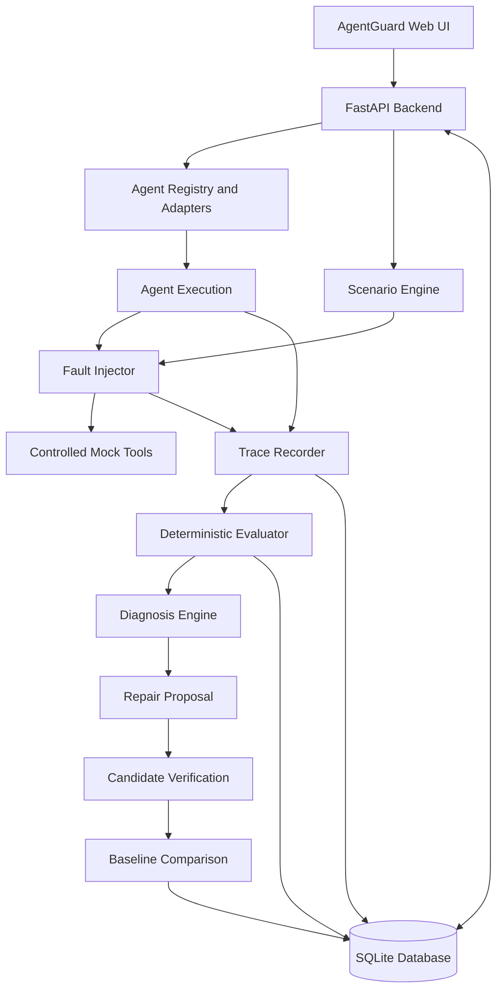

# AgentGuard 🛡️
### AI Agent Reliability Testing, Safety Evaluation & Verified Repair

**Test how AI agents fail. Understand why they fail. Verify whether a proposed fix actually works.**

AgentGuard is an AI agent reliability-testing platform that evaluates agents under controlled failures, records execution traces, detects unsafe side effects, generates evidence-linked diagnoses, and verifies candidate repairs against a baseline.

Instead of trusting an agent's claim that a task succeeded, AgentGuard evaluates its observable behavior against explicit assertions and measurable outcomes.

<p align="center">
  
</p>

<p align="center">
  <strong>Controlled experiments · Observable execution · Evidence-based evaluation · Verified repairs</strong>
</p>

<p align="center">
  
  
  
  
  
  
</p>

---

## 📌 The problem

AI agents can fail in ways that ordinary success/failure checks do not adequately capture.

Consider an agent that creates a support ticket through a tool API.

1. The API successfully creates the ticket.
2. The response is lost because of a timeout.
3. The agent assumes the operation failed and retries.
4. A second ticket is created for the same logical task.
5. The agent reports success, even though an unsafe duplicate side effect occurred.

A successful final response does not necessarily mean a successful execution.

AgentGuard explores how to identify these failures, measure their consequences, and verify safer recovery strategies through controlled experiments.

## 💡 What AgentGuard does

| Capability | Purpose |
|---|---|
| Agent integration | Connect compatible Python, HTTP, framework-based, and model-backed agents |
| Scenario engine | Define repeatable tasks, expected outcomes, faults, and evaluation rules |
| Fault injection | Simulate controlled timeouts, ambiguous outcomes, malformed outputs, repeated actions, prompt injection, and policy violations |
| Execution tracing | Record observable agent steps, tool calls, errors, retries, and outcomes |
| Deterministic evaluation | Evaluate actual results and side effects against explicit assertions |
| Evidence-linked diagnosis | Identify likely failure causes using execution evidence |
| Repair proposals | Review supported candidate fixes before verification |
| Baseline comparison | Compare candidate behavior against a baseline under compatible test conditions |
| Regression detection | Identify previously passing tests that fail after a change |

## 🧪 A core experiment: The ambiguous timeout

AgentGuard includes a controlled ticket-creation experiment designed to demonstrate the difference between naive retry behavior and safer recovery.

### Baseline versus candidate

```text
                    BASELINE AGENT
                          |
                          v
                  Create support ticket
                          |
                          v
                   Ticket is created
                          |
                          v
                  Response is lost
                          |
                          v
                    Blind retry
                          |
                          v
                  Duplicate ticket
                          |
                          v
               Evaluator flags failure


                   CANDIDATE AGENT
                          |
                          v
                  Create support ticket
                          |
                          v
                   Response is lost
                          |
                          v
                Recover operation state
                or reuse idempotency key
                          |
                          v
                 Avoid duplicate action
                          |
                          v
                Evaluator checks outcome
```

The evaluator checks more than whether a ticket exists. It also checks whether duplicate side effects occurred and whether the recovery strategy satisfied the scenario's safety requirements.

### Example verification result

The implementation's reported single-run comparison for the ambiguous-outcome scenario produced the following results:

| Metric | Baseline | Candidate |
|---|---:|---:|
| Task success rate | 0% | 100% |
| Unsafe side-effect rate | 100% | 0% |
| Regressions in the reported comparison | — | 0 |

These are **results from a controlled mock scenario, not a general benchmark of AI-agent reliability**. They demonstrate the intended workflow but do not establish that the candidate will outperform the baseline across arbitrary agents, tasks, or environments.

Reproduce the experiment before using these figures in a presentation or publication.

## 🏗️ Architecture



### Technology stack

**Frontend**
- React
- TypeScript
- Vite
- Tailwind CSS
- Recharts
- React Router

**Backend**
- Python
- FastAPI
- Pydantic
- SQLAlchemy
- SQLite
- pytest

**Agent integration**
- Trusted Python adapters
- HTTP/API adapters
- LangGraph adapter
- OpenAI-compatible model-backed adapter

**Testing and execution**
- Controlled mock tools
- Fault injection
- Structured trace recording
- Deterministic evaluation
- Candidate verification

The default mock-based workflows do not require a paid LLM API key.

## 🔌 Agent integration

AgentGuard uses an adapter-based architecture to connect agents through a common execution contract.

| Integration | Current scope |
|---|---|
| Existing Python agents | Trusted, registered Python callables through a wrapper |
| HTTP/API agents | Compatible endpoints using a documented request/response contract |
| LangGraph | Implemented adapter for compatible graph workflows |
| Model-backed agents | OpenAI-compatible provider interface with controlled tool dispatch |
| CrewAI | Planned integration |
| AutoGen | Planned integration |

Integration does not imply universal compatibility. Each agent must satisfy the relevant contract and scenario requirements.

### Observability levels

AgentGuard distinguishes three levels of observability:

- **Level 1 — Result-only:** final outputs and errors are available.
- **Level 2 — Structured events:** observable steps, tool calls, retries, and errors are provided by the integration.
- **Level 3 — Instrumented tools:** tool calls pass through AgentGuard's controlled tool registry and fault injector.

A result-only integration cannot honestly provide complete internal traces or tool-level fault coverage. Scenario compatibility must reflect these limitations.

## 📊 Reliability metrics

AgentGuard is designed to evaluate several dimensions of agent behavior.

| Metric | What it measures |
|---|---|
| Task success rate | Share of eligible runs meeting defined task and safety requirements |
| Recovery rate | Share of eligible disrupted runs that recover correctly |
| Unsafe side-effect rate | Share of eligible runs containing disallowed or duplicate actions |
| Latency | Execution duration and supported latency percentiles |
| Cost per successful task | Estimated cost when reliable cost inputs are available |
| Regression rate | Share of previously passing eligible tests that fail under a candidate |

Metrics must be derived from actual stored execution results. Their denominators, unsupported scenarios, cancelled runs, and sample sizes matter.

AgentGuard is a research MVP. Its metrics and evaluation rules should be reviewed before using them for production decisions or formal safety claims.

## 🛠️ Getting started

### Prerequisites

- Python 3.10 or a version compatible with the project's dependencies
- Node.js and npm
- Git

Check the repository's dependency files for the exact supported versions.

### 1. Clone the repository

```bash
git clone https://github.com/YOUR_USERNAME/AgentGuard.git
cd AgentGuard
```

### 2. Set up the backend

From the project root, enter the backend directory:

```bash
cd backend
python -m venv .venv
```

Activate the environment on Windows:

```powershell
.venv\Scripts\Activate.ps1
```

Install the dependencies using the repository's dependency manifest. For example, if the project uses `requirements.txt`:

```bash
pip install -r requirements.txt
```

If dependencies are managed through `pyproject.toml`, follow that file's installation instructions instead.

Configure environment variables using the provided `.env.example` if required.

Start FastAPI using the application's documented entry point. For example, if the application exposes `app.main:app`:

```bash
uvicorn app.main:app --reload
```

Open the API documentation at:

```text
http://127.0.0.1:8000/docs
```

### 3. Set up the frontend

Open a separate terminal:

```bash
cd frontend
npm install
npm run dev
```

Open the development URL printed by Vite. In the current development setup, this is expected to be:

```text
http://localhost:5174
```

If the application uses a different configured port, follow the terminal output.

### 4. Run the backend tests

From the backend directory, activate the project's virtual environment and run:

```bash
python -m pytest tests -v
```

### 5. Build the frontend

From the frontend directory:

```bash
npm run build
```

Use the repository's actual entry points and dependency manifests if they differ from these examples.

## 🔍 Example workflow

1. Open the AgentGuard dashboard.
2. Register or select a compatible agent.
3. Choose an executable scenario.
4. Run the agent under the configured fault conditions.
5. Inspect the execution trace.
6. Review the independent evaluator's findings.
7. Generate a diagnosis.
8. Review and approve a supported repair proposal.
9. Execute the candidate verification workflow.
10. Compare baseline and candidate results and inspect regressions.

Repairs are candidates for controlled verification. Approval does not mean a fix is verified, and verification does not deploy the change to production.

## 🔐 Safety and limitations

AgentGuard is designed around controlled testing and explicit execution boundaries.

- The default sample agent uses mock tools and synthetic data.
- Arbitrary uploaded Python files are not executed by the web server.
- Trusted in-process Python adapters run with their process permissions and are not automatically sandboxed.
- HTTP adapters require appropriate destination restrictions and request validation.
- Model-backed integrations require valid credentials for live provider calls.
- Agent-generated success claims are not substitutes for independent evaluation.
- Repair proposals require review and verification.
- CrewAI and AutoGen adapters are not implemented in the current release.

**AgentGuard is a research and engineering MVP, not a production security certification or guarantee of AI-agent safety.**

## 🗺️ Roadmap

- [x] Core web application and API
- [x] Scenario management and JSON import/export
- [x] Controlled mock-agent execution
- [x] Fault injection and structured traces
- [x] Deterministic evaluation
- [x] Diagnosis and candidate repair workflow
- [x] Baseline-versus-candidate verification
- [x] Python and HTTP integration paths
- [x] LangGraph adapter
- [x] OpenAI-compatible model-backed adapter
- [ ] Additional framework adapters, including CrewAI and AutoGen
- [ ] Broader reproducible evaluation across diverse agents and scenarios
- [ ] Stronger isolation for untrusted agent execution
- [ ] Additional benchmark datasets and statistical analysis

## 🧑‍💻 Engineering principles

AgentGuard is built around several principles:

1. **Measure behavior, not claims.** Evaluate observable outcomes independently.
2. **Make failures reproducible.** Use controlled scenarios and fault injection.
3. **Preserve evidence.** Connect evaluation findings to execution traces.
4. **Verify before accepting fixes.** Compare candidates against compatible baselines.
5. **Report limitations honestly.** Distinguish tested behavior from unsupported or unobservable behavior.

## 🤝 Contributing

Contributions, bug reports, test scenarios, and adapter implementations are welcome.

Before contributing:
- Reproduce the issue or define the expected behavior.
- Add or update automated tests.
- Preserve existing safety boundaries.
- Avoid committing credentials or sensitive data.
- Document any limitations of new integrations.

Open an issue before undertaking large architectural changes.

## 📄 License

No license has been specified in this README. Add a `LICENSE` file and update this section before publishing if you intend to grant others permission to use, modify, or distribute the project.

## 👤 Author

**B. Sai Vidwan**

- GitHub: https://github.com/vidwansai66
- LinkedIn: https://linkedin.com/in/vidwansai

---

<p align="center">
  <strong>Build agents. Break them safely. Understand their failures. Verify their recovery.</strong>
</p>
